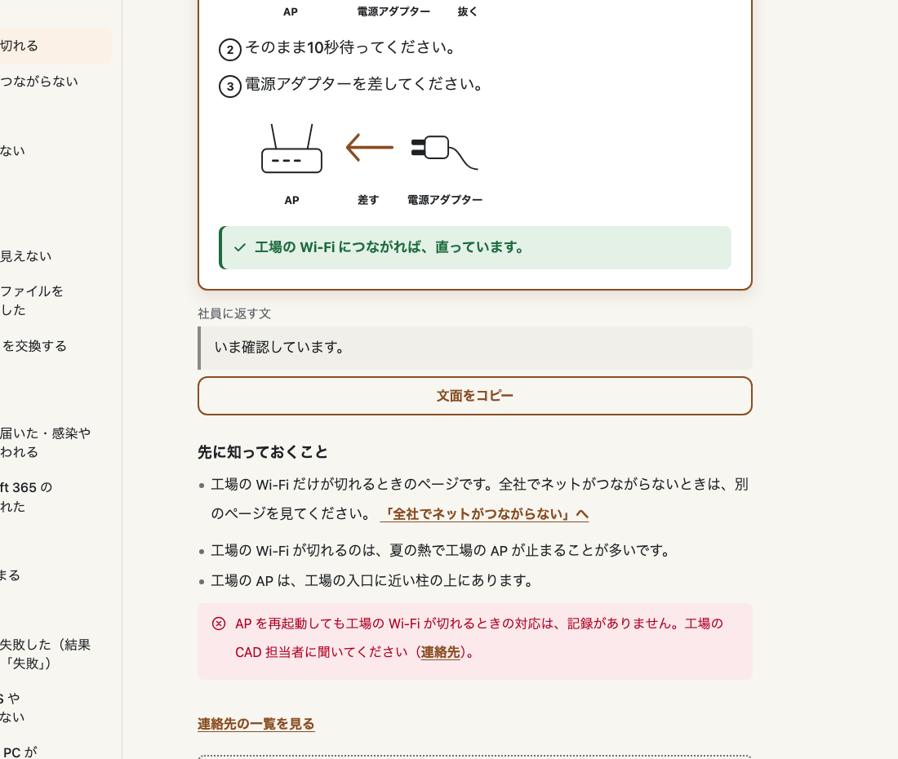
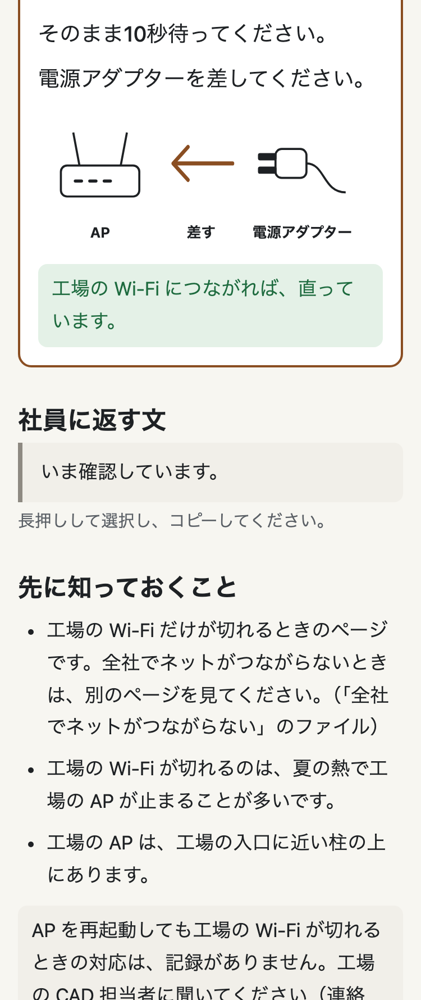
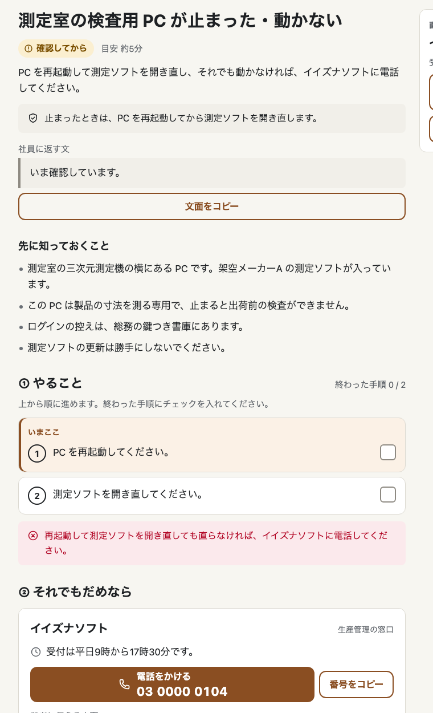
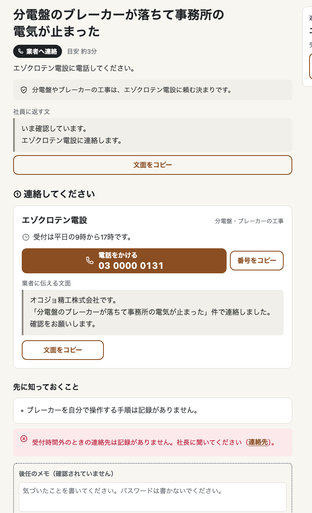
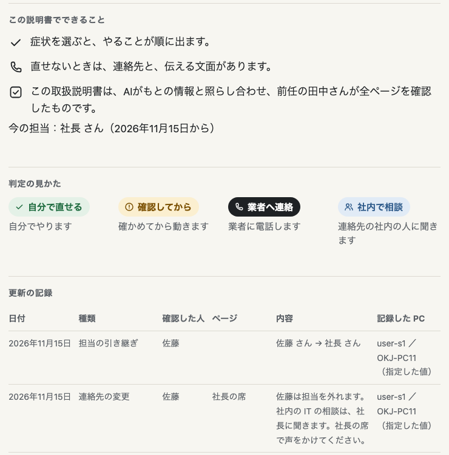
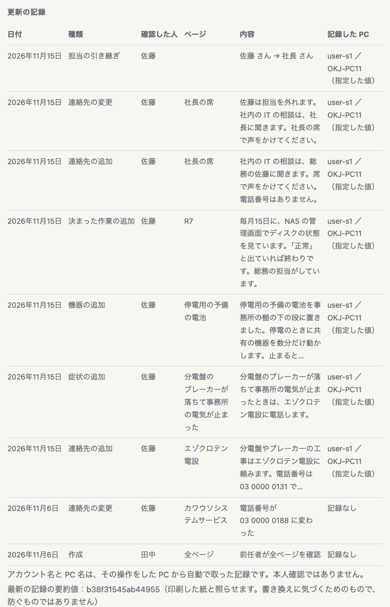
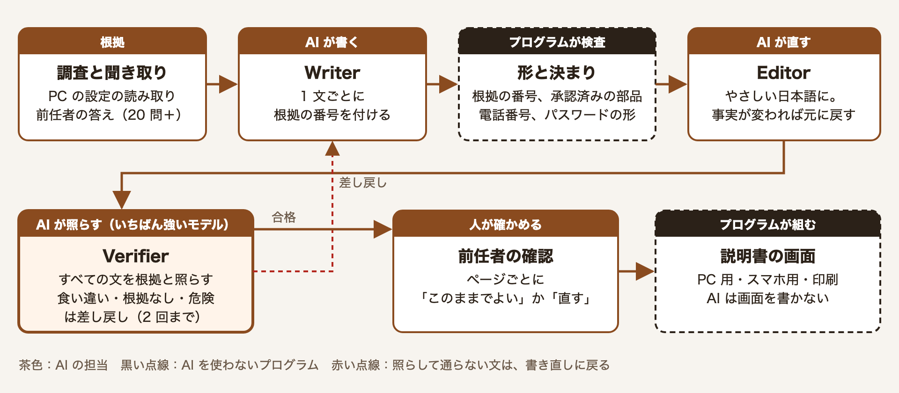

# ヒキツギ

**IT を兼任で見てきた社員が辞めるとき、聞かれたことに答えるだけで、IT 未経験の後任が使える「IT の取扱説明書」を作る Claude Code のプラグインです。**
**後任は、社員に言われたままの言葉で探して、やることと、社員に返す文を見つけます。**

- この版は **v1.0（完成版）** です（リポジトリ `hikitsugi-v1.0`、公開のタグ `v1.0`）。
- 大会（Built with Claude: Japan 2026）に提出した版は、**大会に提出した版**として、リポジトリ `hikitsugi`（タグ `submission-20261108`）に変えずに残しています。

<p></p>

作者：[オコジョソフト（Okojyo-Soft）](https://okojyo-soft.com/)　／　**提出時の動画（3 分。大会に提出した版の画面です）：** https://youtu.be/Ld0LPc5LTOU

> 会社、人物、業者、電話番号はすべて架空です。数字はすべて**模擬評価**（前任者、後任、社員を AI が演じて測ったもの）で、実在の会社では試していません。

**目次：** [今すぐ見る](#今すぐ見るインストール不要)／[誰が、何に困っているか](#誰が何に困っているか)／[使う場面の例](#使う場面の例架空)／[画面を使う順に](#画面を使う順に)／[効果の見積もり](#効果の見積もり)／[使ってみる](#使ってみる)／[AI の間違いをどう防ぐか](#ai-の間違いをどう防ぐか)／[データの扱い](#データの扱い)／[大会に提出した版から変えたこと](#大会に提出した版から変えたこと)／[作らないこと、確かめていないこと](#この版で作らないこと確かめていないこと)／[作り方と試行錯誤](#作り方と試行錯誤)

## 今すぐ見る（インストール不要）
架空の会社「オコジョ精工」の、できあがった説明書を開きます。

**サンプルを開く：** https://devmmou-cpu.github.io/hikitsugi-v1.0/

1. 「PC 用の説明書を開く」を押します
2. 左の「何が起きていますか？」の欄に「フォルダが消えた」と入れ、「共有フォルダが見えない」を押します
3. 判定「自分で直せる」と、手順の図が出ます。「社員に返す文」の「文面をコピー」を押すと、社員に返す文がコピーされます
4. 左の一覧の「工場の Wi-Fi が切れる」では、電源アダプターを抜く・差す手順に絵が付いています
5. スマホでは、入口のページの「スマホ用」の一覧から、症状のファイルを開きます

ネットにつながない PC で見るときは、GitHub の緑の「Code」から「Download ZIP」を選び、展開した `samples/okojo/index.html` を開きます。中身は [PC 用](samples/okojo/manual.html)、[スマホ用の束](samples/okojo/phone/)、[更新用のデータ](samples/okojo/manual.json) です。

サンプルは、11 月 15 日の版で、模擬の前任者の答えから作りました（評価の通しの出力を、プラグインの書き出しで組み直したもの）。手順の絵、自由に足した項目（測定室の検査用 PC）、退職後に聞く道、作成の記録（架空のアカウント名と PC 名）が入っています。

## 誰が、何に困っているか
小さな会社の多くでは、IT をひとりの社員がほかの仕事と兼ねて見ています（**情シス**：情報システムの担当）。その人が辞めると、IT 未経験の総務の社員が後任になり、社員から「共有フォルダが見えない」などの相談を最初に受ける役（**一次受け**）になります。引き継ぎの書類は残らないことが多く、残っても IT を知らない後任には読めません。

| 調べたこと | 数字 | 出典 |
|---|---|---|
| 中小企業の情報システム担当者の置き方 | 専任 11.7%、**兼任 43.9%**、外部委託 15.0%、担当者はいない 28.9% | 東京商工会議所『中小企業のデジタルシフト・DX実態調査』（2025 年 1 月 10 日公表）p.15。調査 2024 年 10〜11 月、主に東京 23 区の中小企業、この設問の回答 1,002 社。https://www.tokyo-cci.or.jp/file.jsp?id=1205203 （2026 年 11 月 6 日閲覧） |
| 中小企業の情報セキュリティの体制 | 組織的には行っていない（各自の対応）69.7%、兼務だが担当者が任命されている 21.0%、専門部署（担当者）がある 9.3% | 独立行政法人情報処理推進機構（IPA）『2024 年度 中小企業における情報セキュリティ対策の実態調査』報告書（2025 年）図 3-28（p.68）。全国、回答 4,191 社。https://www.ipa.go.jp/security/reports/sme/nl10bi000000fbvc-att/sme-chousa-report2024r1.pdf （2026 年 11 月 6 日閲覧） |

公表資料からの引用で、数値は変えていません。IPA の数字は「情報セキュリティの体制」の設問で、「IT の担当者がいない」とは意味が違います。

作者は社内 SE を中心に IT の仕事を 20 年以上続け、IT の引き継ぎを渡す側も受ける側も何度も経験してきました。一次受けの重さを知っているので、後任（このサンプルでは佐藤さん）の側から作っています。

## 使う場面の例（架空）
前任の田中さんが退職した翌週の朝、後任の佐藤さんに、社員から Teams で「共有のフォルダが消えた」と届きます。

| | 佐藤さんがすること | 説明書の画面 |
|---|---|---|
| 1 | PC 用の説明書（1 ファイル）を開く。スマホなら、OneDrive のフォルダから開く | 開くと「困ったとき」の一覧が出る |
| 2 | 言われたままの「フォルダが消えた」を、左の欄に入れる | 近い症状が並び、1 番に「共有フォルダが見えない」 |
| 3 | 判定を見る | 「自分で直せる」。① まずこれだけ（3 つの手順と図）、直ったかの確かめ方 |
| 4 | 「社員に返す文」をコピーして、Teams で返す | 社員が自分の PC でする手順が、そのまま文になっている |
| 5 | 直らなければ、② の連絡先へ | 業者の電話番号と、業者に伝える文 |

佐藤さんには、Claude のアカウントもアプリも要りません。説明書は、ブラウザーで開くだけです。

## 画面を使う順に
### 1. 絵が付いたページ（PC 用）


- **見せているもの：** 「工場の Wi-Fi が切れる」のページです。手順の文の下に、AP（Wi-Fi の電波を出す機器）から電源アダプターを抜く絵と、差す絵があります。
- **どう助けるか：** 文を読み慣れていなくても、触る物と向きが分かります。絵は、承認済みの部品からプログラムが組み立て、手順の文にない物は描きません。

### 2. スマホ用の束


```
ITの取扱説明書（スマホ用）
  00 連絡先
  01 自分で直せる 工場の Wi-Fi が切れる
  02 業者へ連絡 全社でネットがつながらない
  …（1 ファイルに 1 症状、全 15 ファイル）
```

- **見せているもの：** スマホ用の 1 ファイルと、OneDrive に置いたときのフォルダの一覧（上の枠）です。ファイル名の先頭に判定が付きます。
- **どう助けるか：** 席にいなくても、フォルダの一覧を目次にして開けます。JavaScript を使わないので、スマホの OneDrive の表示でも全文が読めます。

### 3. 自由に足した項目


- **見せているもの：** 決まった質問の外で、前任者が「ほかに引き継ぐもの」として挙げた「測定室の検査用 PC」のページです。
- **どう助けるか：** 会社ごとの機器も、前任者の答えだけを根拠に載ります。承認済みの手順がない物なので、「自分で直せる」にはせず、業者の連絡先を出します。

### 4. 更新（ページを足す）


- **見せているもの：** 説明書を作ったあとに、更新で足したページです。同じ更新で足した業者（エゾクロテン電設）が、① の連絡先に出ます。
- **どう助けるか：** 担当が代わっても、Claude Code でページ単位に直せます。足した文も、作るときと同じく根拠と照らします。

### 5. 担当の引き継ぎ


- **見せているもの：** 担当が佐藤さんから社長に代わったあとの「はじめに」です。「今の担当」が出ます。
- **どう助けるか：** 去る人を連絡先・相談先・パスワードの保管場所にしている所がすべて挙がり、直すまで引き継ぎが終わりません。

### 6. 更新の記録


- **見せているもの：** いつ、誰が、どのページを、何のために変えたかの表です。記録した PC の列は、テスト用の架空の値（指定した値）です。
- **どう助けるか：** 担当が何度代わっても、変わった所を追えます。アカウント名と PC 名は記録で、**本人確認ではありません**（PC 用と印刷にだけ出し、スマホ用には出しません）。

## 効果の見積もり
**模擬評価から言えること（すべて上限）**
- 社員の問い合わせの言い方で探して、正しいページが 3 番以内に出たのは、調整に使った 3 社で 86.7〜100%（提出後の 12 回）、開発で一度も開かなかった 2 社で 90.0% と 96.7%（各 1 回）でした。
- 上限である理由：説明書にページがある困りごとだけを測っています。3 番以内に出ても、後任が手順どおりに直せるかは測っていません。前任者役は、知っていることを全部答えます。

**仮定を置かないと言えないこと（数字を出していません）**
- 後任が調べる時間がどれだけ減るか、業者への連絡がどれだけ減るかは、実在の会社で測っていないので、数字を出していません。式と、何を測れば数字になるかは [docs/effect-estimate.md](docs/effect-estimate.md) に書きました。
- 対象になる会社の数は、上の調査の「兼任 43.9%」までです。調査が主に東京 23 区の中小企業なので、全国の社数には引き伸ばしていません。

## 使ってみる
### 入れてから最初の質問まで
**要るもの：** Node.js 22 以上、Claude Code（2.1.275 以上。確かめたのは 2.1.325）、Claude の Pro か Max の契約か API キー。調べる会社の PC は Windows です（試すだけなら要りません）。

```
claude plugin install hikitsugi --marketplace devmmou-cpu/hikitsugi-v1.0
mkdir handover && cd handover
claude
```

Claude Code が開いたら、`/hikitsugi:start` と入力します。会社名、退職する人の名前、まとめた調査データの有無を聞かれます。ここまで 4 行です（ヘッドレスで、最初の質問が出るまでを確かめました。`docs/review/prepublish-check.md`）。

**Windows なしで試すとき：** 同梱の架空の調査データを使います。`handover` フォルダで次を実行し、調査データの場所を聞かれたら `survey.json` と答えます。答えに困ったら、[聞き取りの回答例](docs/video-rehearsal.md) を使えます。
```
curl -LO https://raw.githubusercontent.com/devmmou-cpu/hikitsugi-v1.0/main/eval/sets/okojo/input/survey.json
```

**本番（Windows の PC を調べる）：** 画面に出る調査のコマンドを、調べる PC の PowerShell で実行します。読み取るだけで、外へは送りません。集める内容と集めない内容が出るので、よければ `y` を入力します。できた `hikitsugi-survey-<PC 名>-<日付>.json` をメモ帳で開き、渡したくない内容がないか確かめてから、Claude Code を動かす PC に置きます。調査は 1 台あたり約 10 秒です。
```
powershell -NoProfile -ExecutionPolicy Bypass -File "<プラグインのフォルダ>\scripts\survey.ps1"
```

### かかる時間と費用の目安
| | 目安 | 出どころ |
|---|---|---|
| 全体 | 約 1 時間 10 分（答える部分は約 18 分） | 11/6 の録画の通し（1 回、模擬の回答） |
| その後に増えた問い | 4〜10 問（定番の症状、手順の抜け、ほかに引き継ぐもの） | 評価の通し。時間は測っていません（1 問 約 0.9 分の見積もりで 約 4〜9 分） |
| 書いて、言葉を直し、根拠と照らす段 | 約 20〜25 分 | 実物の通しの段ごとの実測の平均（`docs/night/real-run-report.md`） |
| 費用（Pro か Max） | 追加の費用なし（契約の利用枠は使います） | |
| 費用（API キー） | 担当（エージェント）の呼び出しだけで 1 社 $2.15〜3.27 | 評価の通し 12 回。Claude Code の主のやり取りの分は含みません |

書く段では、始める前に「約 N 分かかります」、ページが 1 枚終わるたびに「15 枚中 4 枚が終わりました。残り約 N 分です。」と出ます。**いちばん長く黙るのは、すべての文を根拠と照らす段で、約 5 分、途中の表示がありません。**画面が止まって見えても動いています。

### できたら
- できるのは、PC 用の 1 ファイル（`manual.html`）、スマホ用のフォルダ、更新用のデータ（`manual.json`）です。
- **3 つとも、会社のアカウントの OneDrive に置いてください。** 版の履歴に、いつ、誰が変えたかが残ります。手元の PC だけに置かないでください。
- 後任は、PC 用を開くか、スマホの OneDrive からフォルダを開くだけです。PC 用では「後任のメモ」を書けます（そのブラウザーにだけ保存され、照らし合わせの対象外です）。

### 担当が代わったら
`manual.json` のあるフォルダで Claude Code を開き、同じ `/hikitsugi:start` を実行します。連絡先・機器・決まった作業を直す・足す、症状のページを足す、手順を直す、後任のメモから取り込む、担当を引き継ぐ、を選べます。1 回の更新は約 2〜8 分、API キーなら約 $0.18〜0.86 でした（実測）。同時に 2 人で更新しないでください。

### うまくいかないとき
- 説明書は、`hikitsugi` のリポジトリを clone したフォルダの中では作らないでください。開発用の検査が動きます。
- 感想や不具合は、[GitHub の Issues](https://github.com/devmmou-cpu/hikitsugi-v1.0/issues) へどうぞ。**報告は任意です。使った結果の報告は求めません。**

## AI の間違いをどう防ぐか


- **AI が出すのは、文章とデータだけです。** 画面は AI ではないプログラムが組み立てます。決まった形のデータ（構造化出力）で受け取り、プログラムが検査して、通らなければ先へ進みません。
- **すべての文を、根拠と照らします。** 照らす担当（Verifier）だけは、見逃すと後任が間違えるので、いちばん強いモデル（Opus）にしています。食い違い、根拠なし、危険な文は書き直しに戻ります（2 回まで）。
- **Editor が数字や名前を変えたら、プログラムが元に戻します。** パスワードの本体らしい答えは、プログラムが記録を拒みます。
- **最後に、前任者がページごとに確かめます。**

| 担当（エージェント：決まった役割の AI） | 役割 | モデル（effort） |
|---|---|---|
| Gap Finder | 調査データと必須 40 項目を比べ、聞くべき空白を出す | Sonnet（medium） |
| Interviewer | 次の 1 問を作る | Sonnet（low） |
| Writer | 根拠のある文だけで、部分ごとに書く | Sonnet（high） |
| Editor | やさしい日本語に直す | Sonnet（medium） |
| Phrase Writer | 社員の普段の言い方で、探すための言葉を作る | Sonnet（low） |
| Figure Planner | 手順の絵の部品の並べ方を選ぶ（形はプログラムが組む） | Sonnet（low） |
| **Verifier** | **すべての文を根拠と照らす** | **Opus（high）** |

### 模擬評価の数字
**holdout**（開発中に中身を一度も開かず、調整にも使わなかった会社）は、提出時の版で各 1 回だけ測りました。v1.0 では、公開の前に 1 回だけ測ります。調整に使った 3 社は、提出時（11/4、1 回）と、提出後の通し（11/14〜11/15、各社 4 回）の最小〜最大です。良く出た回だけを選んでいません。

| 指標 | オコジョ精工 | クズリ運輸 | キノドテン建設 | ラーテル商事（holdout） | ケナガ印刷（holdout） |
|---|---|---|---|---|---|
| 混ぜた誤り 10 件を見つけた数 | 10/10（全 18 回） | 10/10（全 12 回） | 10/10（全 12 回） | 10/10（1 回） | 10/10（1 回） |
| よく似た正しい文 20 件を誤って止めた数 | 0/20（全 18 回） | 0/20（全 12 回） | 0/20（全 12 回） | 0/20（1 回） | 0/20（1 回） |
| 聞き取りの網羅（必須 40 項目）：提出後 4 回 | 36〜37 | 36〜37 | 37〜38 | — | — |
| 同：提出時 | 37 | 37 | 38 | 38 | 36 |
| 探す：3 番以内（目標 95%）：提出後 16 回 | **90.0**〜100%（届いた 14 回） | **90.0**〜100%（11 回） | **83.3**〜100%（9 回） | — | — |
| 同：提出時 4 回 | 96.7〜100%（4 回） | **83.3**〜96.7%（1 回） | **90.0**〜96.7%（2 回） | 100%（1 回） | **86.7%**（1 回） |
| 社員の問い合わせ：3 番以内（目標 90%）：提出後 4 回 | 90.0〜100% | 93.3〜100% | **86.7**〜100%（届いた 3 回） | — | — |
| 同：提出時 | 96.7% | 90.0% | 90.0% | 96.7% | 90.0% |

- **探す：** 模擬の後任が作った探す言葉 30 件で、正しいページが上位 3 件に入った割合です。1 回の通しにつき、問題文を作り直して 4 回測りました。括弧の中は目標に届いた回数です。**社員の問い合わせ：** 模擬の社員の言い方で作った 30 件で、同じように測りました。
- **提出時との比べ：** 探すの平均は、オコジョ精工 98.3% → 98.3%、クズリ運輸 90.0% → 96.9%、キノドテン建設 94.2% → 94.6% です。社員の問い合わせは、提出時の値が提出後の 4 回の幅の中にあります。提出後は 20 問のあとの段が増え、通しごとにページの数が違います。
- **太字**は、目標に届かなかった値（幅の最小）です。誤りの検出の回数は、11 月 2 日〜15 日の評価のすべての回です。回ごとの値は [docs/eval-results.md](docs/eval-results.md) にあります。
- 1 社を最初から通した費用（担当の呼び出し）は、提出時 $1.99〜2.60、提出後 $2.15〜3.27 でした。

## データの扱い
| データ | どこに残るか | 外に送るか |
|---|---|---|
| 調査の結果（PC の設定の読み取り） | 前任者の PC のファイル | ヒキツギ自身はどこへも送りません。Claude Code が読むので、会話として Claude（Anthropic）に送られます |
| 聞き取りの答え | 作業フォルダ（`hikitsugi-work/`）と `manual.json` | 同上（会話として Claude に送られます） |
| パスワード | 残しません。聞くのは保管場所だけです | 答えに本体らしい文字列があれば、プログラムが記録を拒みます。ただし、入力した時点で会話として Claude に送られています。**入力しないでください** |
| できあがった説明書（PC 用、スマホ用、`manual.json`） | 置き場所は本人が決めます（会社の OneDrive をすすめます） | 送りません。説明書は外部のファイルを読み込まず、スマホ用はリンクも JavaScript も使いません |
| 後任のメモ | その PC のブラウザーの中だけ | 送りません |
| 作成・更新した人の名前、アカウント名、PC 名 | `manual.json`、PC 用と印刷の「更新の記録」 | 送りません。スマホ用には出しません |

調査スクリプトは、Windows の PowerShell の標準の機能だけで読み取り、設定を変えず、ほかの機器を調べません。会話のデータの扱いは、使う人の Claude の契約の条件に従います。

## 大会に提出した版から変えたこと
**足したもの**
- 更新で、連絡先・機器・決まった作業を足す・直す。症状のページを足す
- 担当の引き継ぎ（去る人が残る所を直すまで終わらない）と「今の担当」の表示
- 作成と更新の記録に、アカウント名と PC 名（Windows ではドメイン名も）。記録の書き換えに気づくための要約値
- 20 問のあとに、定番の症状 15 件から「相談されたことがあるもの」を選ぶ段（追加は 3 問まで）
- 物に触る手順の抜け（見分け方、待つ時間、確かめ方）を、確認の前に 3 問まで聞く。答えのない項目は「記録がありません」と出す
- 退職後しばらく、社長などを通して前任者に聞ける道（答えがあった会社だけ、「はじめに」に 1 文）
- 「ほかに引き継ぐもの」を自由に挙げる段（任意、5 件まで）
- 手順の絵（キーの絵と、承認済みの部品を並べる絵）
- 書く段の待ち時間の目安と、進み具合の表示
- マーケットプレイスから 1 行で入れる手順と、サンプルの入口のページ

**直した不具合**
- 共有フォルダの `manual.json` から更新すると止まる場合がありました（前の版の文が、`manual.json` に入れない「分からない」の回答を根拠にしているとき）。
- 「電源アダプターをつないでください」のような「つなぐ」の手順を、禁止の文（〜ないでください）と見なして受け付けず、説明書を作れずに止まる場合がありました。
- 症状を足す更新で、AI が連絡先などを空で返すと、それまでの連絡先が消えて止まる場合がありました。

この形で更新した `manual.json` は、大会に提出した版のプラグインでは開けません。

**公開後の変更：** 不具合を直したときは、リポジトリ名を変えず、ここに日付つきで書きます。（まだありません）

## この版で作らないこと、確かめていないこと
### 確かめていないこと
- **実在の会社では試していません。** 前任者も後任も社員も模擬です。調査スクリプトを動かした実機は Windows 11 の 1 台で、複数台は結果の複製で確かめました。
- **人の手では確かめていません（11/11 から）。** 動作は、API を使う自動の通しと、Claude による点検で確かめています。Claude Code の画面での選択肢（AskUserQuestion）の見え方と操作、iPhone の OneDrive での表示は、未確認です。プラグインの流れは、保存した聞き取り（20 問、定番の症状、ほかに引き継ぐもの）をプログラムのコマンドで流し直し、そこから書く段の途中（15 枚中 6 枚）まで、ヘッドレスの Claude Code で動かして確かめました（11/15）。
- **GitHub からの入れ方は、公開の前には確かめられません。** 手元のリポジトリをマーケットプレイスにして確かめました。Windows での入れ方も未確認です。
- 実在の前任者と後任で、後任が社員に返信できるかは測っていません。公開後に、使った人の任意の報告があれば確かめます。

### 仕組みの限界
- 探す仕組みは文字の一致です。言葉が離れると見つかりません。関係のない言葉でも候補を出します。定番の症状のページを足したあと、似た語のページが並び、外れる問いが出ています（例：「電源を入れてから遅い」が停電のページへ）。点数の付け方を 2 通り試しましたが、提出時の水準に戻る案はなく、変えていません。
- 自由に足した項目のページが、別の困りごとの探す言葉を取ることがあります（クズリ運輸の模擬評価で 120 問のうち 1 問）。
- 用語の一言の説明とたとえは、照らし合わせの対象外で、人も承認していません。
- Verifier は、答えにない副詞 1 語の付け足しを通すことがあります（段 1 の通しで 1 件。「すぐ電話してください」の「すぐ」）。
- 更新で、文の中まで自動で直すのは電話番号だけです。
- 調査データや答えに指示が混ざっても資料として扱い、手順は承認済みの部品と聞き取りからしか作りません。調査データだけを根拠にした手順はプログラムが止めます。AI が実際に従わないかは測っていません。
- 物に触る手順の抜けの質問は 3 問までです。それより多いページは「記録がありません」の決まった文になります。確かめ方が、手順のすぐ後ではなく連絡先のあとに出るページがあります。ほかのページへの案内が 2 回並ぶことがあります。
- コピーの手順は、「どこからどこへ」の文が根拠つきで前にあるときだけ使います。戻す範囲の記録がなければ「記録がありません」と出します。
- 手順の絵は、承認済みの型と部品 10 個から組み立てた、型にはめた絵です。実物の写真ではありません。差す・抜くの矢印の絵は、機器と差す・抜く物の両方があるときだけ付けます。機器が文にない手順は、同じ並びの前の手順で同じ物と一緒に出た機器が 1 つだけのとき、その機器を出します。決まらなければ絵にしません。
- 自由に足した物は、前任者の答えだけを根拠に載せ、「自分で直せる」にしません。業務そのものの手順（経理の締めなど）は載せず、題名だけを並べます。5 件より多い物は、まだ聞いていないものに回ります。
- 担当の引き継ぎで去る人を探すのは、名前の文字の照合です。呼び方が違う（あだ名、役職だけ）と見つかりません。
- **本人確認はしていません。** 更新する人の名前は自己申告です。アカウント名と PC 名は、ほかの人の PC で開けばその人のものになり、環境変数でも変えられます（「指定した値」と出ます）。要約値の鎖で、記録の書き換えには次の更新で気づけますが、作り方を知っていれば鎖ごと作り直せます。誰が変えたかを確かに追うには、OneDrive の版履歴を見てください。読める人・直せる人は、置くフォルダの共有設定で決めてください。
- 印刷では、「更新の記録」の「記録した PC」の列が狭く、PC 名が 1〜2 文字ずつ折り返されることがあります。
- スマホ用の束には、機器の一覧がありません（症状ごとのページと連絡先だけ）。
- 調査スクリプトと必須 40 項目は、Windows の事務所を前提にしています。Mac だけの事務所は対象外です。

### 作らないこと
- 用語の辞書、探す精度の作り込み、実物の写真、絵の部品を 10 個程度より増やすこと、退職後に聞く道の期限による表示の切り替え。
- 「実在の会社では未検証」「模擬評価」の但し書きは残します。

## 作り方と試行錯誤
### 作り方
| 工程 | 使ったもの | モデル（effort） |
|---|---|---|
| 実装、テスト、評価の実行、夜間と日中の自動作業 | Claude Code | Claude Opus 5.5（全コミットの記録）。effort は high |
| プラグインの 7 つの担当 | Claude Code のサブエージェント | 上の「AI の間違いをどう防ぐか」の表のとおり |
| 評価：模擬の田中さん、模擬の後任と模擬の社員 | Anthropic API（`eval/`） | Haiku 5.5（low） |
| 評価：点数の計算 | プログラム（AI なし） | — |
| 後任役の通読 | Claude Code のサブエージェントと Anthropic API | Opus 5.5 |
| 設計の壁打ち、批評、README と動画の点検、統計の調べもの | claude.ai | Claude Fable 5.1 |
| 判断、承認、実機確認、録画、ナレーション | 作者 | — |

- 作者は、何を作るかの判断、手順部品と図と絵の型の承認、Windows と iPhone の実機確認、動画を担当しました。
- 提出前に Claude Security（公式プラグイン）でリポジトリ全体を点検し、指摘 1 件（`manual.json` の `round` の値を確かめずにファイル名に使っていた）を直しました。公開前には、すべてのブランチとタグの履歴で、キーの形、この PC の名前、実在の会社のデータがないことを確かめました（`docs/review/prepublish-check.md`）。

### 試行錯誤
- **数字を良く見せない：** 正解データは、理由を書いた単独のコミットでしか変えません。holdout は開かず、最後に 1 回だけ測ります。外れた回も表に入れています。
- **探す精度の後退：** 定番の症状のページを足したら、似た語のページが並んで外れる問いが増えました。点数の付け方を 2 通り試しましたが、3 社とも戻る案がなく、仕組みは変えずに限界に書きました（`docs/eval-results.md`）。
- **テストが落ちたままコミットできた：** 点検の出力を `tail` につないだため、終了コードを見落としました。点検に合格した中身（index の tree）を記録し、違えばコミットを止める作りにしました。
- **ヘッドレスで見つけた止まる不具合：** 定番の症状を選ぶ段の答えを、CLI が標準入力から読んでいませんでした。テストは関数を直接呼んでいたので気づけず、プログラムのコマンドを通して流したときに見つかりました。標準入力を読むコマンドの一覧が、答えを受け取る関数と食い違えば落ちるテストを足しました。
- **矢印が何もない所を指していた：** 「電源アダプターを差してください。」の絵に差す先の機器がなく、作者の指摘で、前の手順から機器を 1 つに決められるときだけ出す決まりにしました。

### 作者
[オコジョソフト（Okojyo-Soft）](https://okojyo-soft.com/)。社内 SE を中心に IT の仕事を 20 年以上続けています。

### 文書
[設計書](docs/design.md)、[評価結果](docs/eval-results.md)、[効果の見積もり](docs/effect-estimate.md)、[開発の記録](docs/journey.md)、[録画の手順と回答例](docs/video-rehearsal.md)、[開発の約束](CLAUDE.md)、[LICENSE](LICENSE)（MIT）
